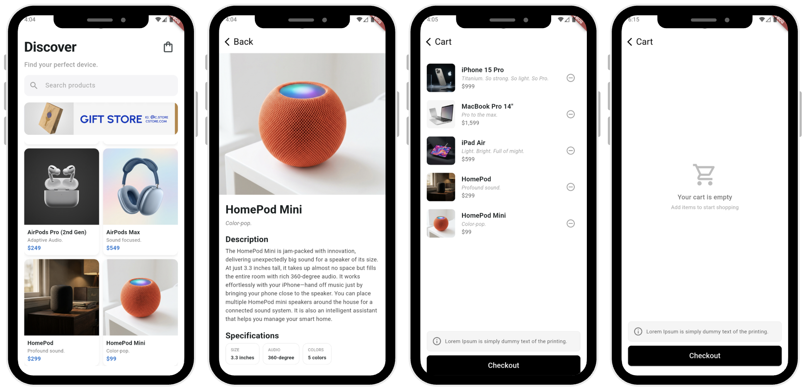
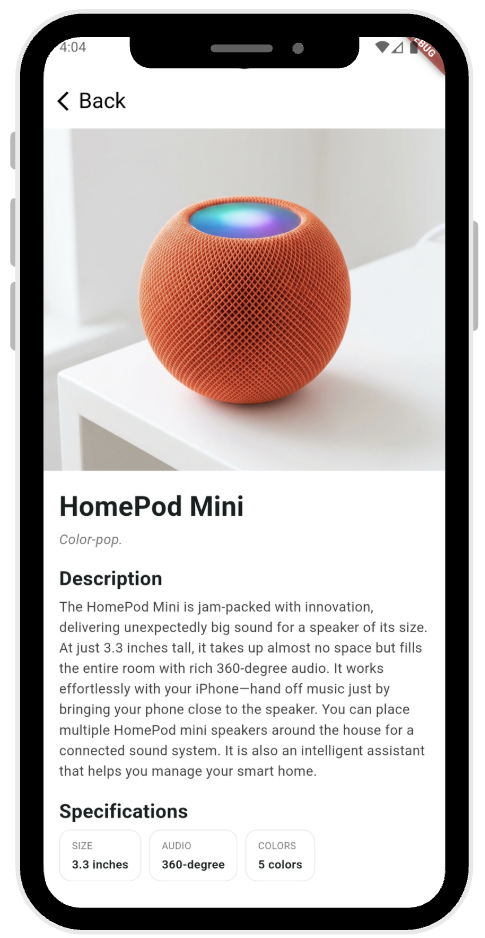
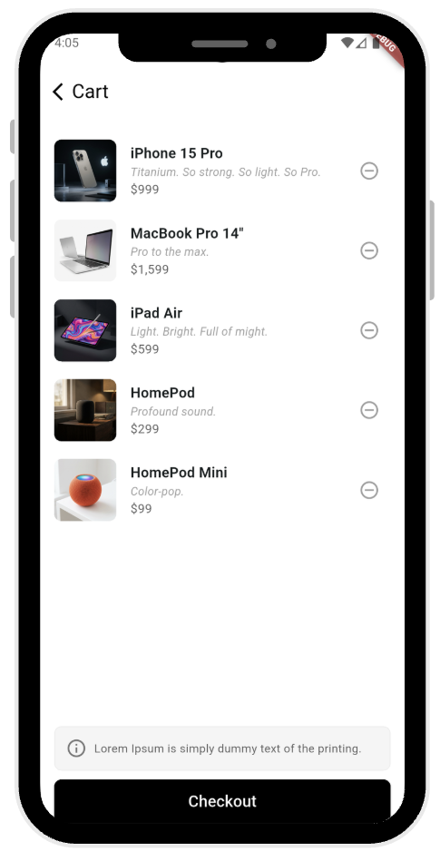
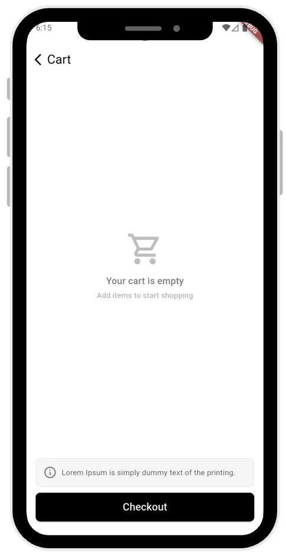

# Mini Katalog Uygulaması (Mini Catalog App)

Flutter ile geliştirilmiş, modern ve profesyonel tasarıma sahip **Mini Katalog Mobil Uygulaması**. Bu proje, 5 günlük Flutter temel eğitim müfredatının tüm kazanımlarını eksiksiz olarak içerecek şekilde geliştirilmiştir.

---

## 📱 Uygulama Ekran Görüntüleri (Screenshots)



| 1. Keşfet / Ürün Listesi (Discover) | 2. Ürün Detay Sayfası (Product Detail) | 3. Sepet Sayfası (Cart) | 4. Boş Sepet Ekranı (Empty Cart) |
| :---: | :---: | :---: | :---: |
|  |  |  |  |

---

## 📌 Proje Açıklaması ve Kapsamı

Bu uygulama, Flutter ekosisteminin temel yapı taşlarını öğretmek amacıyla tasarlanmıştır:
- **Temiz Mimari ve Klasörleme**: `models`, `screens`, `widgets`, `data`, `state`, `theme`, `routes` katmanları.
- **Sıfır Dış Bağımlılık**: Proje yönergesine uygun olarak **hiçbir harici paket kullanılmamış**, yalnızca Flutter'ın yerel `material.dart` kütüphanesi ve Dart standart kütüphaneleri (`dart:convert`) tercih edilmiştir.
- **Çift Yönlü Veri ve Varlık Yönetimi**: `assets/data/products.json` simülasyonu ve `assets/images/` yerel görsel önbelleği sayesinde uygulama hem çevrimdışı (offline) hem de çevrimiçi (online fallback) kararlı bir şekilde çalışır.
- **Dinamik State Yönetimi**: Sepet ekleme, adet artırma/azaltma, toplam hesaplama ve canlı arama filtrelemesi Flutter'ın yerleşik `ChangeNotifier` ve `InheritedNotifier` mimarisiyle reaktif olarak yönetilmektedir.

---

## 📅 5 Günlük Eğitim Kazanımları

| Gün | Konu Başlığı | Projede Uygulanan Özellikler |
| :--- | :--- | :--- |
| **Gün 1** | **Flutter'a Giriş & Temeller** | Standart proje yapısı, `StatelessWidget` ve `StatefulWidget` mantığı, widget ağacı entegrasyonu. |
| **Gün 2** | **Dart Temelleri & Temel Widget'lar** | Null-safety, Dart koleksiyonları (`List`, `Map`), `Text`, `Container`, `Row`, `Column`, `Padding`, `Expanded`, `Card`, `ListTile`, `ElevatedButton`. |
| **Gün 3** | **Sayfa Mantığı & Navigasyon** | `Navigator.push`, `Navigator.pop`, `MaterialPageRoute`, İsimlendirilmiş Rotalar (`Named Routes`) ve Sayfalar arası veri taşıma (`Route Arguments`). |
| **Gün 4** | **Listeleme, JSON & Görsel Yönetimi** | `Product` model sınıfı (`fromJson` / `toJson`), `ListView.builder`, `GridView.builder`, `Image.asset` ile yerel görsel yönetimi, dinamik metin araması ve kategori filtreleme. |
| **Gün 5** | **Mini Katalog Final Uygulaması** | Modern kart tabanlı ürün ızgarası (`GridView`), zengin ürün detay sayfası, dinamik sepet yönetimi ve sipariş tamamlama simülasyonu. |

---

## 🛠 Kullanılan Araçlar ve Sürümler

- **Flutter SDK**: `3.47.6` (channel stable)
- **Dart SDK**: `3.13.5`
- **Geliştirme Ortamı**: Visual Studio Code / Android Studio
- **Paketler**: `flutter/material.dart` (Varsayılan) - Ekstra 3. parti paket kullanılmamıştır.

---

## 📂 Proje Klasör Yapısı

```text
mini_katalog_app/
├── android/                   # Android yerel yapılandırması
├── ios/                       # iOS yerel yapılandırması
├── assets/
│   ├── data/
│   │   └── products.json      # Eğitim amaçlı simüle edilen ürün JSON verisi
│   ├── images/                # Ürün ve kampanya görselleri (Offline destek)
│   └── screenshots/           # Uygulama ekran görüntüleri
├── lib/
│   ├── data/
│   │   └── product_data.dart  # JSON okuma ve asenkron veri yükleme servisi
│   ├── models/
│   │   └── product.dart       # Product ve CartItem veri modelleri (fromJson/toJson)
│   ├── routes/
│   │   └── app_routes.dart    # Rota tanımları, Named Routes ve Route Arguments
│   ├── screens/
│   │   ├── home_screen.dart   # Keşfet, arama, banner ve ürün ızgarası ekranı
│   │   ├── product_detail_screen.dart # Ürün detay, özellikler ve sepete ekleme
│   │   └── cart_screen.dart   # Sepet listesi, adet kontrolü, özet ve boş sepet
│   ├── state/
│   │   └── cart_state.dart    # Saf Flutter ChangeNotifier/InheritedNotifier sepet durumu
│   ├── theme/
│   │   └── app_theme.dart     # Apple/Material 3 esintili sade ve modern tema
│   ├── widgets/
│   │   ├── banner_card.dart   # Kampanya / Promosyon kartı
│   │   ├── cart_item_tile.dart# Sepet listesi satır widget'ı
│   │   ├── custom_search_bar.dart # Anlık arama ve temizleme çubuğu
│   │   └── product_card.dart  # GridView ürün kartı widget'ı
│   └── main.dart              # Uygulama başlangıç noktası (MaterialApp & CartScope)
├── test/
│   └── widget_test.dart       # Uygulama başlatma birim testi
├── pubspec.yaml               # Varlık ve proje yapılandırma dosyası
└── README.md                  # Proje dokümantasyonu
```

---

## 🚀 Kurulum ve Çalıştırma Adımları

Projeyi bilgisayarınızda çalıştırmak için aşağıdaki adımları izleyebilirsiniz:

### 1. Depoyu Klonlayın
```bash
git clone <GITHUB_REPOSITORY_URL>
cd mini_katalog_app
```

### 2. Gerekli Bağımlılıkları Yükleyin
```bash
flutter pub get
```

### 3. Kod Analizi ve Testleri Çalıştırın
```bash
flutter analyze
flutter test
```

### 4. Uygulamayı Başlatın
Bir Android emülatör, iOS simülatör veya fiziksel cihaz bağlı iken:
```bash
flutter run
```

---

## 🌐 Veri Kaynağı Bilgisi

Projedeki ürün verileri ve görselleri eğitim ve demo amaçlı olarak [wantapi.com](https://wantapi.com/products.php) mock API servisi referans alınarak modellenmiş ve uygulamanın internet olmadan da kusursuz çalışabilmesi için yerel varlık (asset) olarak projeye dahil edilmiştir.

---

## 👤 Geliştirici & Teslimat
- **Proje Adı**: Mini Katalog Uygulaması
- **Platform**: Flutter (Android & iOS)
- **Lisans**: MIT
